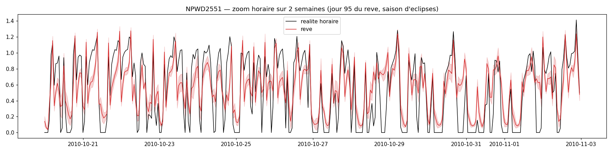
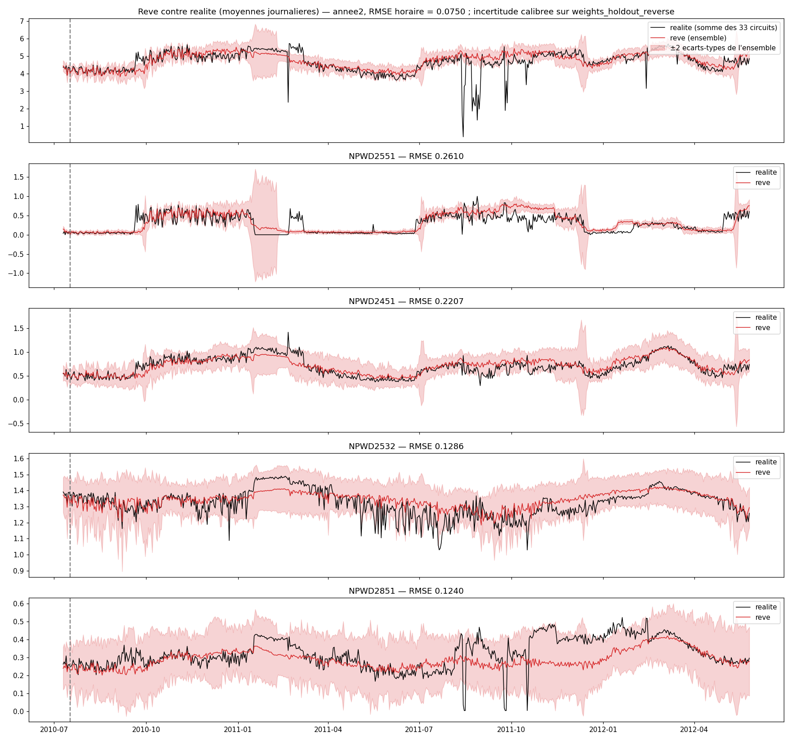
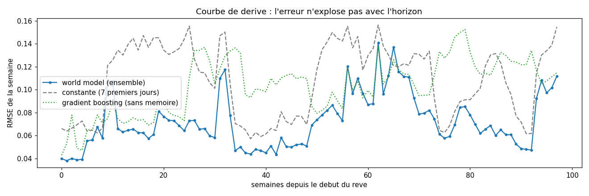
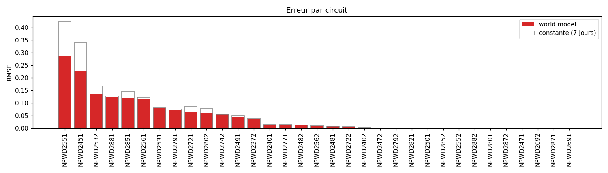
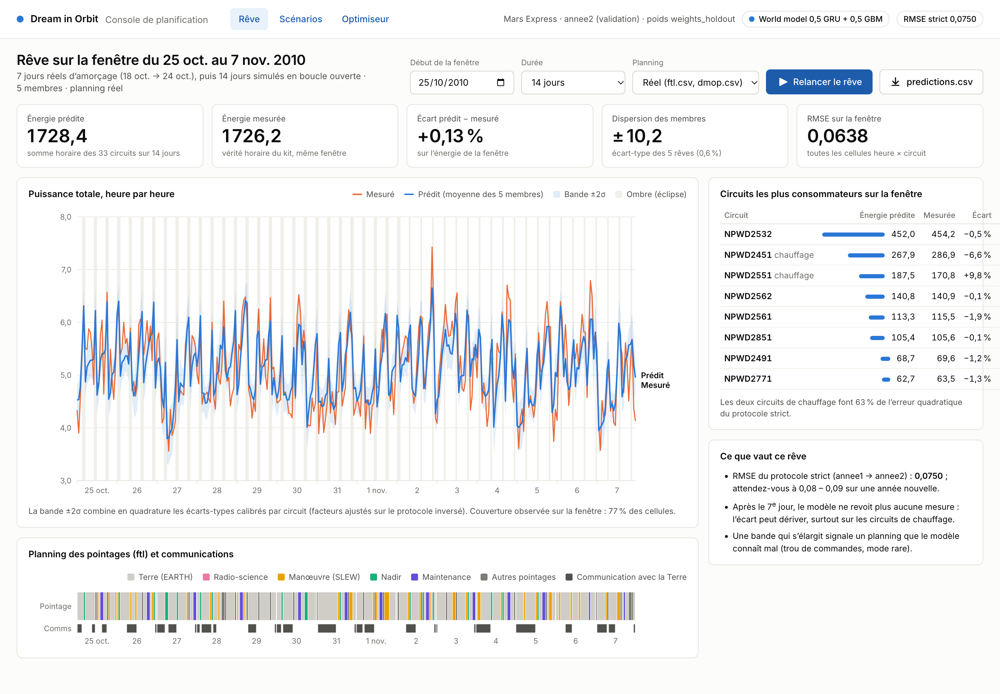
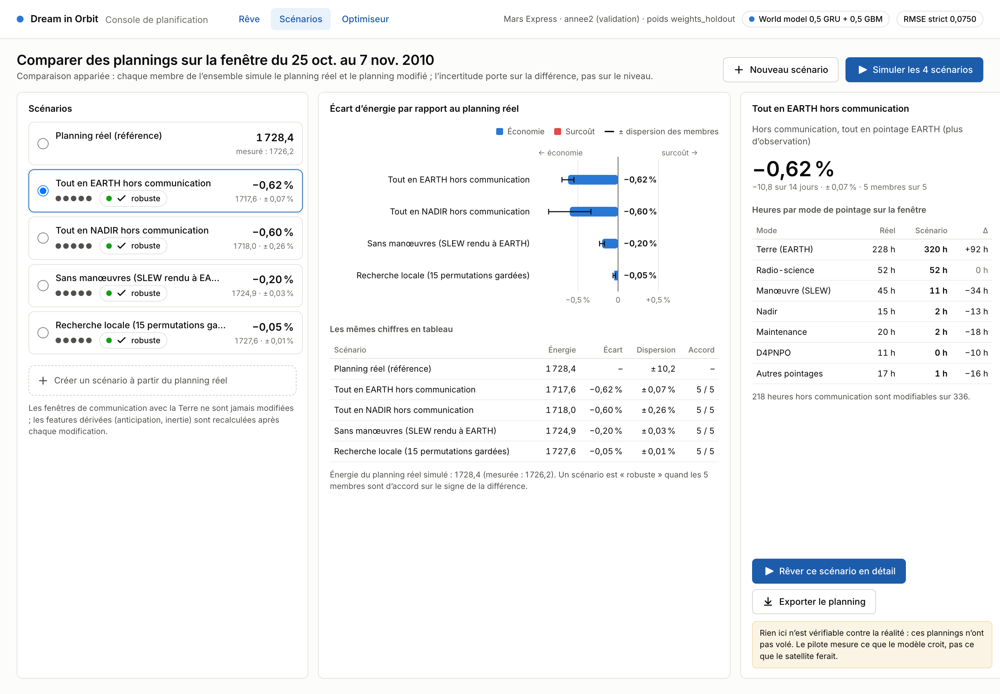

Dépôt : https://github.com/kenzi0228/dream-in-orbit (code, poids, rapport long `RAPPORT.md`, démo `demo/index.html`, maquette `maquette/`).

# 1. Le problème et mes choix

Le kit donne deux années de télémétrie de Mars Express : la puissance de 33 circuits (fichier `power.csv`), les commandes envoyées à bord (`dmop`), le planning de pointage (`ftl`), les angles solaires (`saaf`), les événements orbitaux (`evtf`) et des tendances journalières (`ltdata`). Le but est un *world model* : on lui montre 7 jours réels, puis il doit « rêver » la consommation heure par heure sur tout le reste de la période, sans jamais revoir une mesure. L'évaluation est la RMSE de `evaluate.py`.

Mes choix principaux :

* **Un GRU avec état caché, entraîné en mode « stateful »**. Je découpe la période en flux contigus et je fais avancer le réseau par segments de 168 h en lui transmettant son état. C'est ce qui rend la simulation libre stable sur 16 000 pas : un réseau entraîné sur des fenêtres indépendantes dérive.
* **Scheduled sampling**. 15 époques en teacher forcing, puis le réseau est de plus en plus souvent nourri par sa propre prédiction. Sans ça, la RMSE passe de 0,075 à 0,087.
* **Pas de calendrier dans les entrées**. Les features du type « distance Terre-Mars » permettent au réseau de mémoriser l'année d'entraînement. Je les ai retirées, et toutes les « heures depuis le dernier événement » aussi, qui servaient d'horloge.
* **Un composant gradient boosting en plus du réseau**. Un GBM par circuit, sans mémoire, qui ne voit que l'heure courante. Seul il est moins bon que le GRU, mais ses erreurs sont peu corrélées avec celles du réseau (0,75 contre 0,97 entre deux GRU). Le mélange à parts égales gagne 0,005 de RMSE. Le règlement autorise un modèle classique « comme composant », et `train.py --combine none` donne la version réseau pur si besoin.
* **Deux protocoles de validation, puis un troisième « vierge »**. Toutes mes décisions ont été prises sur annee1 → annee2 (strict) et sur les deux ans → dernière demi-année (chronologique). Le protocole inversé (annee2 → annee1) a été ajouté à la fin, sans aucune décision prise dessus, pour mesurer l'optimisme de sélection.

# 2. Architecture

{width=14cm}

```
x_t      = features de l'heure t (contexte + planning, 162 colonnes)
h_t      = GRU(h_{t-1}, MLP([x_t, y_{t-1}]))            état caché 128
ŷ_t^GRU  = tête(h_t)                                    33 circuits
ŷ_t      = 0,5 × moyenne de 5 GRU (graines)  +  0,5 × GBM(x_t)
```

* Entrées du GRU : angles solaires, ombres et occultations, phase orbitale, type de pointage, constante solaire, durées d'éclipse, et les **comptes horaires de commandes par famille** (sans la lettre de variante, voir § 3).
* GBM : un `HistGradientBoostingRegressor` par circuit (600 arbres, 15 feuilles), bagging temporel en 5 sacs, 684 colonnes.
* Incertitude : écart-type des 5 membres, multiplié par un facteur par circuit calibré sur une année et vérifié sur l'autre. Brut, l'écart-type est sous-dispersé d'un facteur 11 ; calibré, la bande ±2σ couvre 95 % des cellules.
* Interface officielle : `train.py` (une commande, ~70 min sur 6 cœurs) et `predict.py --test_dir ... --out predictions.csv`.

# 3. Mes erreurs et ce que j'ai corrigé

**Teacher forcing pur.** Mon premier GRU était bon en prédiction à un pas et catastrophique en simulation libre (0,13, pire que la constante à 0,106). Correction : scheduled sampling + état transmis entre segments, 0,088 dès la première semaine.

**Le calendrier comme fuite.** J'avais mis distance Terre-Mars et angle Soleil-Mars-Terre dans les entrées. Le modèle collait à l'année d'entraînement et faisait 0,088 ; sans ces colonnes, 0,083.

**Les lettres des commandes.** C'est l'erreur qui m'a coûté le plus de temps. Les commandes `dmop` ont une forme du type `AXXX301A` : un radical (la famille) et une lettre de variante. J'avais encodé l'état de 77 interrupteurs par commande complète, et le GRU tombait à 0,103. En décomposant l'erreur année par année, j'ai découvert que **les lettres changent d'une année martienne à l'autre** (20 interrupteurs sur 29, 49 commandes du vocabulaire présentes seulement en annee2). Tout ce qui est appris par lettre est perdu l'année suivante. J'ai refait les features avec les radicaux seulement (comptes horaires par famille, changements de variante à venir) : première vraie amélioration du GRU depuis la semaine 1, et le GBM passe de 0,089 à 0,079.

**Une fuite dans le vocabulaire.** Mon vocabulaire de features (liste des familles de commandes, des types de pointage) était construit sur les deux années, donc le modèle entraîné sur annee1 « connaissait » des colonnes de annee2. Corrigé en apprenant le vocabulaire sur l'entraînement seul. Ça ne changeait rien au score (0,07509 → 0,0750), mais la fuite existait.

**L'empilement.** J'ai essayé de faire lire au GRU la prédiction du GBM pour qu'il la corrige. Résultat 0,091, bien pire que le mélange simple. Les prédictions hors-échantillon des sacs sont des erreurs d'extrapolation de saison qui ne ressemblent pas aux erreurs du GBM au test. Le GRU apprend à corriger des erreurs qui n'existent plus. Abandonné.

**Ce que j'ai essayé et rejeté**, mesuré à chaque fois sur les deux protocoles : LSTM, 256 neurones, 2 couches, SWA, perte Huber, adaptation au test sur les 7 jours réels (sur-apprend une semaine : 0,104), forêts aléatoires dans le mélange, poids de mélange par circuit (sur-apprennent la période de validation), pondération des données récentes, moyennes exponentielles. Le journal complet est dans `RAPPORT.md` § 8.

# 4. Résultats, avec preuves

Toutes les RMSE ci-dessous sont celles de `evaluate.py` du kit, sur la simulation libre complète après 7 jours réels. Les fichiers de prédiction de validation et les rapports JSON sont versionnés dans le dépôt (`weights_holdout*/val_report.json`, `reports/`), et `run_all.sh` relance toute la chaîne.

| Modèle | strict (annee1 → annee2) | inversé (annee2 → annee1) | chronologique |
|---|---|---|---|
| Constante (moyenne des 7 jours) | 0,106 | 0,125 | 0,105 |
| Gradient boosting seul | 0,0792 | 0,0908 | 0,0816 |
| Ensemble de 5 GRU seul | 0,0796 | 0,0952 | 0,0884 |
| **World model livré (0,5 GRU + 0,5 GBM)** | **0,0750** | **0,0901** | **0,0805** |

Flux officiel reproduit de bout en bout (`make_validation.py` → `predict.py` → `evaluate.py`, poids `weights_holdout`) : **0,074968** sur 530 409 cellules. Le bruit entre graines est de ±0,001, donc je ne considère pas significatif un écart inférieur à 0,002.

Le modèle livré dans `weights/` est entraîné sur les deux années. Sur une année nouvelle, le chiffre honnête est **entre 0,08 et 0,09** (protocoles inversé et chronologique), pas 0,075.

{width=16.5cm}

{width=16.5cm}

**D'où vient l'erreur restante.** Deux circuits de chauffage, NPWD2551 et NPWD2451, font 63 % de l'erreur quadratique, et 60 % de l'erreur vient de 1,5 % des cellules : des marches, pas du bruit. Le plus gros écart (NPWD2551, août-novembre 2011) commence le 30 août 2011, premier jour d'un **trou de 14 jours dans le fichier de commandes**, dans une saison qui contient une famille de commandes absente de annee1. Un modèle entraîné sur annee1 n'a aucun moyen d'apprendre ces heures. Un oracle qui corrigerait ce seul biais ramènerait la RMSE vers 0,071 : c'est à peu près le plancher avec ces données.

{width=14cm}

# 5. Démo et bonus pilote

La démo (`demo/index.html`, sans serveur ni bibliothèque) raconte le projet en quinze écrans, de la mesure brute au pilote. La maquette `maquette/` est une console de planification en trois écrans construits sur les résultats réels.

{width=16.5cm}

**Pilote.** Le world model sert de simulateur pour comparer des plannings sur ces 14 jours. Comparaison appariée : chaque membre de l'ensemble simule le planning réel et le planning modifié, on regarde la différence et l'accord des membres. Tout en pointage Terre hors communication : −0,62 % d'énergie, mais on n'observe plus rien. Sans manœuvres : −0,20 %. Une recherche locale qui permute des heures de pointage dans chaque journée sans retirer d'observation trouve −0,05 % (5 membres d'accord sur 5). Conclusion honnête : le chauffage dépend d'abord de l'ombre et du Soleil, pas du planning, et ces plannings n'ont jamais volé, donc rien n'est vérifiable.

{width=16.5cm}

# 6. Ce que je retiens

Le gain n'est pas venu de l'architecture (treize variantes testées, aucune au-dessus du bruit) mais de la lecture des données : comprendre que les lettres des commandes ne se transfèrent pas, et qu'un second modèle non corrélé vaut plus qu'un réseau plus gros. Avec deux années seulement, la discipline de validation (deux protocoles, puis un troisième jamais utilisé pour décider) a été ce qui m'a empêché de me raconter des histoires.
